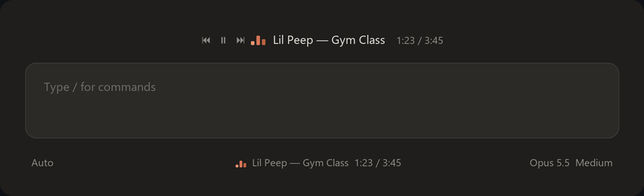

<div align="center">

# claude-code-player

**See what's playing, right inside Claude Code.**

The track from any app: Spotify, Yandex Music, VK, SoundCloud, Telegram, a browser, or local files.


**English** · [Русский](README.ru.md)



</div>

## Install

**In the Claude app:** click **+** next to the prompt → **Plugins** → **Add marketplace**, enter `playsin333/claude-code-player`, then **Add plugin** → `now-playing`.

**In the terminal:**

```
/plugin install now-playing --marketplace playsin333/claude-code-player
```

Then type `/player` to open the settings panel.

## Features

- The artist and title above the prompt, aligned left, center or right.
- The same line at the bottom, next to the model picker.
- Previous, pause and next buttons beside the track, so you can switch music without leaving Claude.
- The track time: `1:23 / 3:45`.
- Synced lyrics in place of the title: words appear one by one as they are sung. Off by default.
- Colors for the equalizer and the word being sung: the Claude palette, Neon, Sunset, a rainbow RGB that cycles, or any color you pick with a click.
- Listening stats with `/player stats`: today and the last seven days, top artists and tracks. Counted on your machine only, no tokens spent.
- Hide sources you don't want, for example a browser playing YouTube.
- An `▂▅▃` equalizer, either with its own smooth animation or live, bouncing to the real sound (Windows).
- On pause the bars lie flat and the text dims; when nothing plays, the player disappears.
- Cleans titles of junk like `(Official Video)` and splits browser titles of the form `Artist - Track`.
- Every setting is a button in `/player` and is remembered between sessions.

## Platforms

The track comes from the operating system, not from each service, so the player sees any app that tells the system what it is playing.

| System | How | Notes |
| --- | --- | --- |
| **Windows 10 / 11** | System media sessions, the same ones the volume flyout shows | Full support, including the live equalizer. Uses the built-in Windows PowerShell. |
| **Linux** | MPRIS players through `busctl` (ships with systemd) | Spotify, Firefox, Chrome/Chromium, VLC, Rhythmbox, Elisa, mpv with mpris and most others. No live equalizer yet. |
| **macOS** (experimental) | Spotify and Music through `osascript` | Since macOS 15.4 Apple closed general now-playing access, so browsers are not visible. Not yet tested on a real Mac; reports are welcome. |

## Settings

Type `/player` and a panel with buttons appears in the chat. The panel is in Russian for now; the text commands below do the same thing:

| Command | What it does |
| --- | --- |
| `/player top off\|left\|center\|right` | the band above the prompt |
| `/player size small\|normal` | its text size |
| `/player bottom off\|on` | the line at the bottom, next to the model |
| `/player buttons off\|on` | playback buttons above the prompt |
| `/player time off\|on` | the track time |
| `/player lyrics off\|on` | lyrics in place of the title |
| `/player color claude\|neon\|sunset\|rgb\|mono` | the palette for the equalizer and the sung word |
| `/player color #ff5fd2` | any color of your own |
| `/player equalizer frames\|live` | animated or live equalizer |
| `/player next` / `prev` / `pause` / `play` | control the music |
| `/player stats` | what you listened to today and this week |
| `/player off` / `/player on` | turn everything off or on |
| `/player debug` | what is going on inside, for bug hunting |
| `/player bug` | report a bug: a link to the form and diagnostics for it |

## Privacy

The model never sees the track. Only when lyrics are on, the artist and title are sent to [lrclib.net](https://lrclib.net), an open lyrics database, to fetch the synced text. Stats stay on your machine.

## How it works

On Windows, `helper/now-playing.ps1` asks the system for all media sessions twice a second and prints one line of JSON on every change. Ten times a second it also reads the peak meter, the same one the volume mixer shows, which drives the live equalizer. The mod (`hooks/register.tsx`) starts the script, reads its output, picks what to show and draws the player. A button press is written to a temporary file that the script picks up within a tenth of a second and passes to the app.

On Linux and Mac no script is needed: the mod polls the players once a second through `busctl` or `osascript` and presses their buttons the same way.

```
helper/now-playing.ps1   reads the track from Windows
hooks/linux.ts           Linux players over MPRIS and busctl
hooks/mac.ts             Spotify and Music on Mac via osascript
hooks/register.tsx       draws the player and answers /player
hooks/equalizer.tsx      the self-animating equalizer
hooks/clock.tsx          the self-updating track time
hooks/lyrics.tsx         lyrics that appear word by word
hooks/picker.tsx         the strips for picking your own color
hooks/colors.ts          palettes and shade math
hooks/stats.ts           listening stats
types/index.d.ts         player state types
tests/                   tests (claude plugin test .)
```

## Bugs, questions, ideas

Open an [issue](https://github.com/playsin333/claude-code-player/issues):

- [report a bug](https://github.com/playsin333/claude-code-player/issues/new?template=bug.yml): the easiest way is to run `/player bug` in Claude first and paste what it prints into the form;
- [ask a question or suggest an idea](https://github.com/playsin333/claude-code-player/issues/new?template=question.yml).

## Roadmap

- Live equalizer on Linux, via PipeWire or PulseAudio.
- More players on Mac, if Apple opens access again.

Changes are listed in [CHANGELOG.md](CHANGELOG.md) (in Russian).

License: [MIT](LICENSE).
