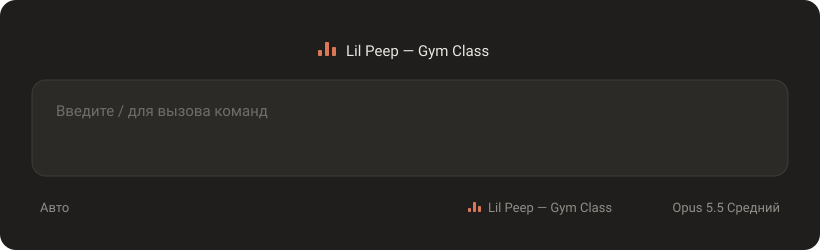

<div align="center">

# claude-code-player

**Что сейчас играет — прямо в Claude Code.**

Трек из любого приложения: Spotify, Яндекс Музыка, ВК, SoundCloud, Telegram, скачанная музыка.




</div>

## Что умеет

- Показывает автора и название трека над полем ввода: слева, по центру или справа.
- Дублирует их строчкой внизу, рядом с моделью.
- Кнопки «назад», «пауза» и «вперёд» рядом с треком: переключить музыку можно, не уходя из Claude.
- Время трека: сколько прошло и сколько всего, `1:23 / 3:45`.
- Текст песни на месте названия: слова появляются по одному, когда их поют. Включается отдельно.
- Лишние источники можно скрыть: например, браузер с YouTube, чтобы плеер показывал только музыку.
- Эквалайзер `▂▅▃` прыгает, пока трек играет, и замирает на паузе, а текст тускнеет.
- Когда ничего не играет, плеер исчезает.
- Чистит названия от мусора вроде `(Official Video)` и разбирает браузерное «Артист - Трек».
- Все настройки меняются кнопками в `/player` и запоминаются между сессиями.

Трек берётся из системных медиасессий Windows, тех же, что показывает плашка громкости. Поэтому плеер видит любое приложение, которое сообщает туда, что играет, без отдельной настройки под каждый сервис.

## Установка

**В приложении Claude:** нажми **+** рядом с полем ввода → **Plugins** → **Add marketplace**, введи `playsin333/claude-code-player`, затем **Add plugin** → `now-playing`.

**В терминале:**

```
/plugin install now-playing --marketplace playsin333/claude-code-player
```

Нужна Windows 10 или 11 со встроенным Windows PowerShell (`powershell.exe`, он есть в системе по умолчанию).

## Настройки

Напиши `/player` — в чате появится панель с кнопками:

```
Играет: Lil Peep — Gym Class (Spotify)
[⏮ назад] [⏸ пауза] [вперёд ⏭]

Над полем ввода   [выкл] [слева] [по центру] [справа]
Размер текста     [маленький] [обычный]
Внизу             [выкл] [вкл]
Кнопки            [выкл] [вкл]
Время трека       [выкл] [вкл]
Текст песни       [выкл] [вкл]
Источники         [Spotify: Lil Peep — Gym Class] [Chrome: YouTube]
```

В «Источниках» выделены приложения, которые плеер показывает. Нажми на приложение, чтобы скрыть его, и ещё раз, чтобы вернуть.

То же самое можно сделать текстом:

| Команда | Что делает |
| --- | --- |
| `/player top off\|left\|center\|right` | полоса над полем ввода |
| `/player size small\|normal` | размер её текста |
| `/player bottom off\|on` | строчка внизу, у модели |
| `/player buttons off\|on` | кнопки над полем ввода |
| `/player time off\|on` | время трека |
| `/player lyrics off\|on` | текст песни вместо названия |
| `/player next` / `prev` / `pause` / `play` | управлять музыкой |
| `/player off` / `/player on` | выключить или включить всё |
| `/player debug` | что происходит внутри, для поиска багов |
| `/player bug` | сообщить о баге: ссылка на форму и диагностика для неё |

## Как это устроено

`helper/now-playing.ps1` раз в полсекунды спрашивает у Windows все медиасессии и при каждом изменении печатает одну строку JSON. Мод (`hooks/register.tsx`) запускает скрипт, читает его вывод, выбирает, что показать, и рисует плеер. Когда нажимаешь кнопку, мод кладёт команду во временный файл, а скрипт в течение десятой доли секунды забирает её и передаёт приложению. Модель эти данные не видит. В интернет уходят только исполнитель и название трека, и только если включить текст песни: тогда плагин ищет его на [lrclib.net](https://lrclib.net), в открытой базе текстов. Там почти всегда известно, когда начинается каждая строка, а время отдельных слов плагин рассчитывает сам, по их длине.

```
helper/now-playing.ps1   читает трек из Windows
hooks/register.tsx       рисует плеер и отвечает на /player
hooks/equalizer.tsx      эквалайзер, который анимируется сам
hooks/clock.tsx          время трека, которое обновляется само
hooks/lyrics.tsx         текст песни, который появляется по словам
types/index.d.ts         типы состояния плеера
tests/                   тесты (claude plugin test .)
```

## Баги, вопросы, идеи

Пиши в [Issues](https://github.com/playsin333/claude-code-player/issues), там на каждую тему своё обсуждение:

- [сообщить о баге](https://github.com/playsin333/claude-code-player/issues/new?template=bug.yml): проще всего сначала набрать в Claude `/player bug` и вставить в форму то, что он ответит;
- [задать вопрос или предложить идею](https://github.com/playsin333/claude-code-player/issues/new?template=question.yml).

Обе ссылки есть и внизу панели `/player`.

## Планы

- **2.0** — Linux (через MPRIS, для тех, кто сидит в терминале), macOS, если получится, и совместимость с плагинами, которые тоже рисуют над полем ввода.

История изменений — в [CHANGELOG.md](CHANGELOG.md).

Лицензия — [MIT](LICENSE).
